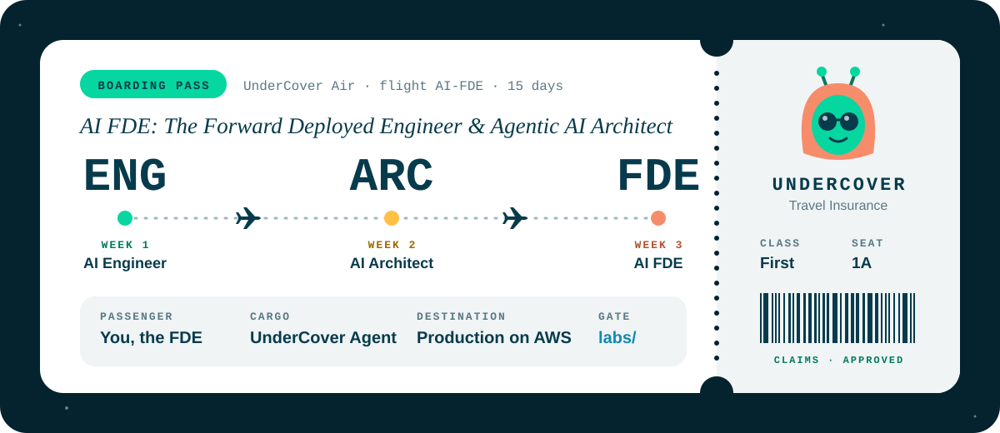
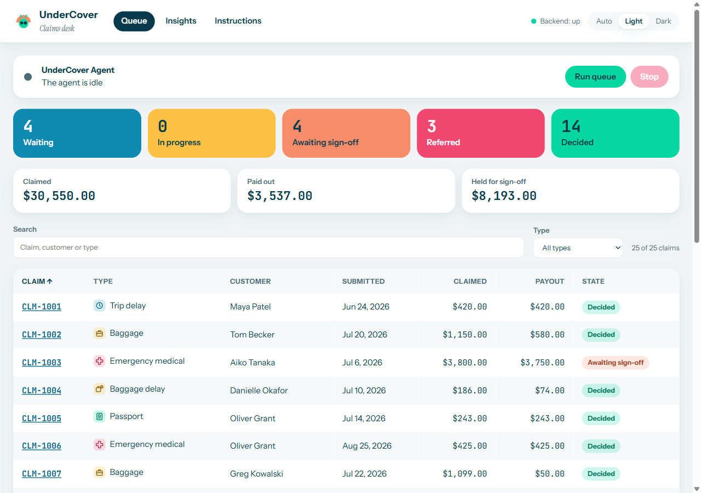
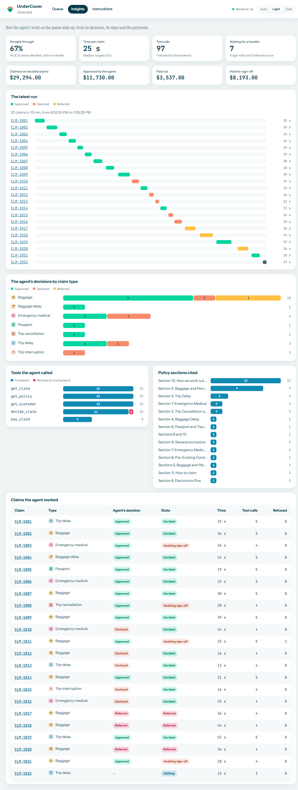
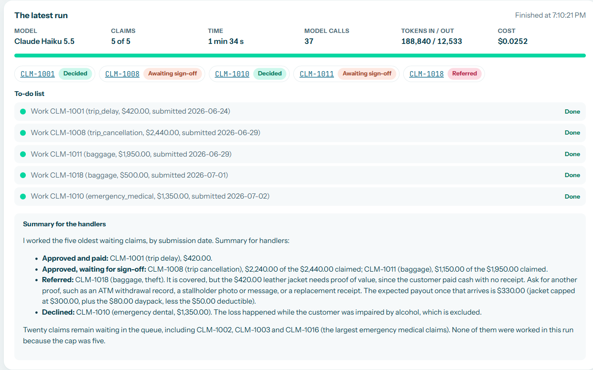
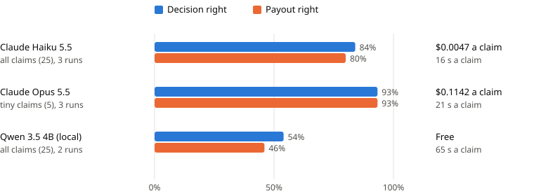
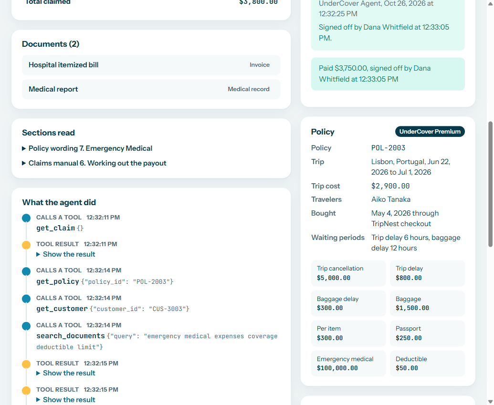
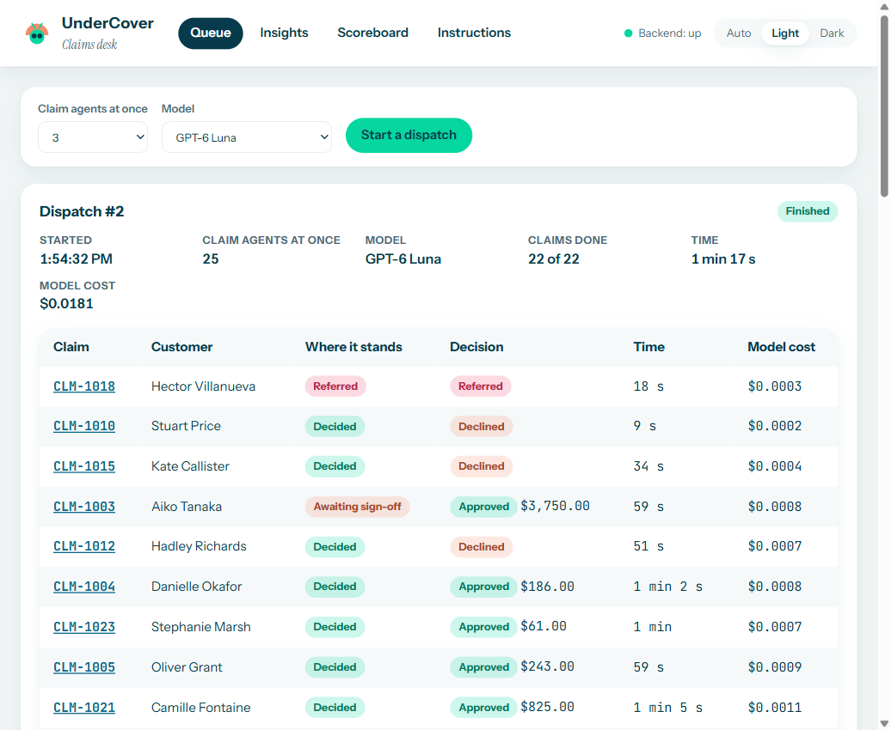

# AI FDE Agentic Engineering

**Forward Deployed Engineering, built day by day on Ed Donner's UnderCover.**

> **Thank you, Ed.** This repo is my fork of Ed Donner's [ed-donner/undercover](https://github.com/ed-donner/undercover), the project behind his Udemy course [AI FDE: The Forward Deployed Engineer & Agentic AI Architect](https://www.udemy.com/course/ai-fde-forward-deployed-engineer-agentic-ai-architect/learn/lecture/58544007#questions). The course, the product briefs, the data and the idea of UnderCover are all his, and building it day by day has been the most practical way I have found to learn agentic engineering. If you want the course itself, its labs and Ed's own builds, start at his repo; his curriculum is at [edwarddonner.com/curriculum](https://edwarddonner.com/curriculum).

## UnderCover Agent: the Travel Insurance Platform



UnderCover is a fictional travel insurer. The course builds its claims platform: a backend that holds the records and enforces the rules, an AI agent that works the claims through the backend's API, and a dashboard where the claims handlers watch it, sign off or reject large payouts and finish the claims it refers.

This README describes what I added on top of Ed's builds. Each day's build here starts from Ed's brief, but on my own code rather than his day branch, and each finished day is kept on a locked branch:

| Branch | What it is | Compared with |
|---|---|---|
| [`week1day3-end`](https://github.com/Darko-Martinovic/ai-fde-agentic-engineering/tree/week1day3-end) | The pilot from `docs/SPEC.md` | Ed's `week1day3-end` |
| [`week1day5-end`](https://github.com/Darko-Martinovic/ai-fde-agentic-engineering/tree/week1day5-end) | The harness from `docs/HARNESS.md`, with Insights and the model comparison | Ed's `week1day5-end` |
| [`week2day1-end`](https://github.com/Darko-Martinovic/ai-fde-agentic-engineering/tree/week2day1-end) | Langfuse tracing, the Week 2 Day 1 lab and challenge | |
| [`week2day2-end`](https://github.com/Darko-Martinovic/ai-fde-agentic-engineering/tree/week2day2-end) | The Week 2 Day 2 lab and challenge | |
| [`week2day3-end`](https://github.com/Darko-Martinovic/ai-fde-agentic-engineering/tree/week2day3-end) | Durable state from `docs/DURABLE.md`, with a handler's rejection | Ed's `week2day3-end` |
| [`week2day4-end`](https://github.com/Darko-Martinovic/ai-fde-agentic-engineering/tree/week2day4-end) | The swarm from `docs/SWARM.md`: a dispatcher with many claim agents at once, evaluations and the Scoreboard | Ed's `week2day4-end` |
| `main` | The latest build, where work goes in through PRs | |

## Week 1: the AI Engineer

### Day 3: the pilot



| | Ed's build | Mine |
|---|---|---|
| Running the agent | Command line | Command line, and Run and Stop in the dashboard. The agent runs as a separate process, one run at a time, and Stop ends it at once (since Week 2 Day 3 the claim it was working stays in progress for the next run to carry on) |
| Referrals | A referral is final | A `referred` state and a form where a handler approves or declines the claim |
| Queue | Counts by state and a line per claim | Tiles per state that filter the table, money totals, search, a type filter and sortable columns |
| After a run | Each decision printed, then a count | Insights, built just after the pilot: claims straight through, time per claim, a timeline of the latest run, tool calls and refusals, decisions by claim type, the sections cited and the money claimed, paid and held, from one read-only endpoint ([docs/PLAN_INSIGHTS.md](docs/PLAN_INSIGHTS.md)) |
| API | 13 operations | 19 at the pilot (35 now), with a Postman collection that runs through the workflow and starts and stops the agent |



### Day 5: the harness



| | Ed's build | Mine |
|---|---|---|
| Capped runs | `uv run -m agent --cap 5` | The same, and Run 5 and Run all in the dashboard, with the number of claims in a field |
| Model | DeepSeek V4.1 Flash on OpenRouter, or `MODEL_NAME` | Any model in `settings/models.toml`, on OpenRouter, Anthropic or a local Ollama, picked in the dashboard or with `--model`. The running model is shown, never written in code |
| Settings | Defaults in code, such as the backend's URL | `settings/.env.defaults` (committed), `.env` and `settings/models.toml` with prices. No host, port, URL, model id or price in code, and tests that fail if one appears |
| Watching a run | The latest run's to-do list and summary | A live run panel: model, claims done of the cap, time taken and left, model calls, tokens and cost, the to-do list, and the claim being worked with its steps arriving |
| Usage | Not recorded | Each model call's tokens, cost and time, on the run |
| Accuracy | Not scored | The model comparison, below |

The plan is [docs/PLAN_HARNESS.md](docs/PLAN_HARNESS.md).

**The model comparison.** `uv run -m bench` runs each trial in `bench/plan.toml` from a fresh database, through the same harness the dashboard uses, and scores every claim against the handlers' own decisions: the decision, and for an approval the payout within a dollar. Only `bench/score.py` reads the answer key in `data/evals/`; the agent and the backend never do, and a test checks it. It refuses to pass a budget (`BENCH_BUDGET_USD`) and resumes from the runs it has saved.



| Model | Claims | Runs | Decision right | Payout right | Cost a claim | Time a claim |
|---|---|---|---|---|---|---|
| Claude Haiku 5.5 | all 25 | 3 | 84% | 80% | $0.0047 | 16 s |
| Claude Opus 5.5 | the 5 tiny | 3 | 93% | 93% | $0.1142 | 21 s |
| Qwen 3.5 4B, local | all 25 | 2 | 54% | 46% | free | 65 s |

The whole comparison cost $2.06. The full report, with every claim each model got wrong, is [bench/results.md](bench/results.md).

## Week 2: the AI Architect

### Labs and challenges

Each challenge is a notebook in [community_contributions/Darko-Martinovic](community_contributions/Darko-Martinovic), kept with its outputs: Days 1 and 2 ran on Claude Haiku 5.5, Days 3 to 5 on GPT-6 Luna.

| Day | Challenge | What it found |
|---|---|---|
| 1 | The payout tool with the full policy wording against a concise one, 3 runs each on the 25 harder claims, as Langfuse experiments | The concise wording saved 16% of the input tokens but dropped accuracy from 0.89 to 0.80 and raised the cost of mistakes from $130 to $1,212 a run |
| 2 | A word lookup in place of Qdrant, a notes file per customer and a research sub-agent, on the 25 even harder claims | The word lookup got every claim right, against 0.96 for Qdrant, and was cheaper. Notes kept from one run to the next dropped accuracy to 0.84 |
| 3 | The lab's graph with a rejection: the handler's answer carries `approved` and a `note` | On CLM-1011 a note that names the rule fixed both wrong payouts in five runs; a rejection with no reason made a right payout wrong |
| 4 | The swarm's dispatcher with a `score_run` node, then checkpointed in Supabase, killed partway and picked up | With `max_concurrency=5` it saved no result before the kill, so every claim it had started was worked again; the claim agents still cost only a few model calls, picking up from their own saved steps |
| 5 | The short policy wording as a lever for the improver, with a control that swaps in the short wording alone | The improver kept the full wording, rightly: the short one dropped the grade from 1.24 to 0.81 (no section numbers to cite) and saved nothing, since the full prompt was already 98% cached |

### Day 3: durable state



The brief moves the records to Supabase, makes the claim agent a LangGraph graph that saves its progress after every step, pauses a payout over $1,000 for a handler and has the agent's own service pick the claim up after the sign-off. I added the other answer a handler can give: reject the payout with a note.

```
dashboard ──/api──> backend (FastAPI) ──SQLAlchemy Core──> Supabase, schema "undercover"
                       │  a review is saved, then
                       │  POST /api/claims/{id}/resume
                       v
                   agent's service (port 8002) ──┐
                                                  ├── claim graph ── PostgresSaver ──> Supabase
   uv run -m agent, or Run on the dashboard ─────┘
```

| | Ed's build | Mine |
|---|---|---|
| A held payout | A handler signs it off and the agent pays | Sign off, or reject with a note. After a rejection the agent looks at the claim again with the note and decides again, and that decision always goes back to a handler; a payout rejected twice is referred |
| Repeats | A repeated decision or payment counts as done; a claim has one decision, and the agent makes one tool call at a time | The same for repeats, but a rejection means a claim can have several decisions, so each claim has a `revision`: two decisions or payments at the same moment are recorded once, and the one that loses gets a repeat or a refusal |
| Stop | Command line only, with no Stop | Run and Stop on the dashboard. Stop leaves the claim in progress with its saved progress, and the next run, or Carry on on the claim's page, carries on every claim left in progress |
| Code | The graph, the checkpointer, the runs and the queue agent in one `harness.py`; every route in `main.py` | `graph.py`, `checkpoints.py`, `harness.py`, `queue_agent.py` and `service.py`; the claim rules in `claim_rules.py`, the handlers' reviews in `reviews.py`, all SQL in `backend/store/` |
| Tests | 20 unit test files | 45, and Playwright tests where a review reaches a stand-in for the agent's service |

In the live trial on Claude Haiku 5.5, Run 5 worked five claims in 1 min 5 s for $0.02; signing off CLM-1008 on the dashboard showed it paid four seconds later, with no model call, and its Langfuse session holds the work before the pause and the payment after it. A queue run killed partway carried on from its last step the next time. The plan, with what isn't covered, is [docs/PLAN_DURABLE.md](docs/PLAN_DURABLE.md).

### Day 4: a swarm of claim agents and a scoreboard



The brief replaces the queue agent with a dispatcher that has no model: a LangGraph graph in the lab's style that works every claim left in progress and every waiting one with up to N claim agents at once, each on its own thread, with its pause for a sign-off and its recovery after a restart. A rate limit or a timeout waits and carries the claim on; any other failure gets one more try. Every model call's cost and every spell of work are recorded with their run, and a Scoreboard scores evaluations on copies of the labelled claims with the lab's measures.

```
dashboard ──/api──> backend ──> Supabase: claims, model calls, work times, runs, the answer key
                       │  start_dispatch / start_evaluation / stop_run / resume_claim
                       v
                   agent's service ── dispatcher (LangGraph, no model, max_concurrency = N)
                                          │ a Send per claim
                                          v
                                   harness.work_in_run ── claim graph, its own thread and PostgresSaver
```

| | Ed's build | Mine |
|---|---|---|
| Stop | None on the dashboard | A graceful Stop: no more claims start, those working finish, and the dispatch shows Stopped |
| Model | `MODEL_NAME` only | A model picker on the dispatch and evaluation forms, `MODEL_NAME` chosen, recorded on each run |
| Cost | OpenRouter's `usage.cost` | The same, or else the prices in `settings/models.toml`, so Anthropic and Ollama runs have a cost too |
| A held payout | Sign-off only, refused on a copy | Sign-off or rejection; both refused on a copy, and a handler can't decide a copy left for them |
| The model comparison | None | `bench/` rebuilt on evaluations: the backend is the only scorer, and only seeding reads `data/evals/` |
| Limits and tests | 25 written in three places | `MAX_AGENTS` once in `settings/.env.defaults`; a test that a claim graph saves under its own thread and never as the dispatcher's subgraph; Postman for every operation |

The live trial on GPT-6 Luna: a dispatch at N=3 killed partway with every process on port 8002, then one at N=25 that carried on the three claims left in progress as the same attempts and worked the other 19, all 22 starting within 3.6 seconds and finishing in 77 seconds against 1,221 seconds of claim work, for $0.02. Its first try stalled the backend: requests waiting for the 4 database connections took every thread, so the backend now keeps 200. The evaluation set at N=25 scored 84% on decisions and accuracy, and the held-out set's five tiny claims 100%. Every run of the day cost $0.09. The plan is [docs/PLAN_SWARM.md](docs/PLAN_SWARM.md), and the runs are in [docs/STATUS.md](docs/STATUS.md).

## How it's built

- **Standards checked by tests.** Ed's code standards 1 to 14 plus eight more in [docs/CODE_STANDARDS.md](docs/CODE_STANDARDS.md), enforced by `tests/test_standards.py`, `dashboard/src/standards.test.ts`, ESLint and ruff, or by review: one owner for each service's address, one name for each operation, all SQL in `backend/store/`, functions under 40 lines and modules under 300, complexity limits, and no configuration in code.
- **Reviewed and merged by PR.** As in Ed's process, a fresh agent reviews every change against the standards before it is committed ([docs/PROCESS.md](docs/PROCESS.md)). On top of that, a pre-commit hook runs every check, each phase goes in through its own PR, and `main` and the day branches are protected.
- **Tests that never call a model.** Agent tests script a stub model, save progress in memory and run the real backend in-process, on SQLite. Playwright end-to-end tests run on their own ports and database, and a Postman collection covers the whole API.

## Running it

Install [uv](https://docs.astral.sh/uv/) and Node, then from the repo root:

```
uv sync
npm install
cp settings/.env.example .env     # add a model key, DATABASE_URL and, for traces, the Langfuse keys
uv run -m backend.seed   # load data/ into Supabase
npm run dev              # backend on 8000, the agent's service on 8002, dashboard on http://localhost:5173
```

`DATABASE_URL` is a Supabase project's session pooler connection string; the records and the agent's saved progress go in the `undercover` schema. Without it the backend and the dashboard run on SQLite, but the agent doesn't start, since it can't save its progress.

| Task | Command |
|---|---|
| A dispatch of the queue, or an evaluation | The queue page's Start a dispatch, or the Scoreboard's Start an evaluation, with `npm run dev` running |
| One claim, on a model from `settings/models.toml` | `uv run -m agent CLM-1001 --model anthropic:claude-haiku-5-5` |
| Reset the data | `uv run -m backend.seed` |
| Every check | `npm run check` |
| End-to-end tests | `npm run e2e` |
| The model comparison (calls the models; `--estimate` prints its cost) | `uv run -m bench` |

A local model needs [Ollama](https://ollama.com) with the model pulled, such as `ollama pull qwen3.5:4b`, and costs nothing. [docs/STATUS.md](docs/STATUS.md) describes everything that is built and every live run.

## Shared with the course

My contributions to Ed's repo, in `community_contributions/Darko-Martinovic/`:

| PR | Day | What |
|---|---|---|
| [#11](https://github.com/ed-donner/undercover/pull/11) | Week 1 Day 3 | The pilot and Insights (`PILOT.md`) |
| [#24](https://github.com/ed-donner/undercover/pull/24) | Week 1 Day 5 | The harness and the model comparison (`HARNESS.md`) |
| [#49](https://github.com/ed-donner/undercover/pull/49) | Week 1 Day 2 | Challenge: the cheapest model for the agent |
| [#51](https://github.com/ed-donner/undercover/pull/51) | Week 1 Day 4 | Challenge: fewer tokens with the same accuracy |
| [#30](https://github.com/ed-donner/undercover/pull/30) | Week 2 Day 1 | Challenge: concise wording with the payout tool |
| [#37](https://github.com/ed-donner/undercover/pull/37) | Week 2 Day 2 | Challenge: word lookup, customer notes and a research sub-agent |
| [#52](https://github.com/ed-donner/undercover/pull/52) | Week 2 Day 3 | Challenge: a handler can reject a payout |
| [#56](https://github.com/ed-donner/undercover/pull/56) | Week 2 Day 3 | Durable state, with a handler who can sign off or reject (`DURABLE.md`) |
| [#57](https://github.com/ed-donner/undercover/pull/57) | Week 2 Day 4 | Challenge: `score_run`, and a restart partway through a dispatch |
| [#63](https://github.com/ed-donner/undercover/pull/63) | Week 2 Day 5 | Challenge: the short policy wording as a lever |
